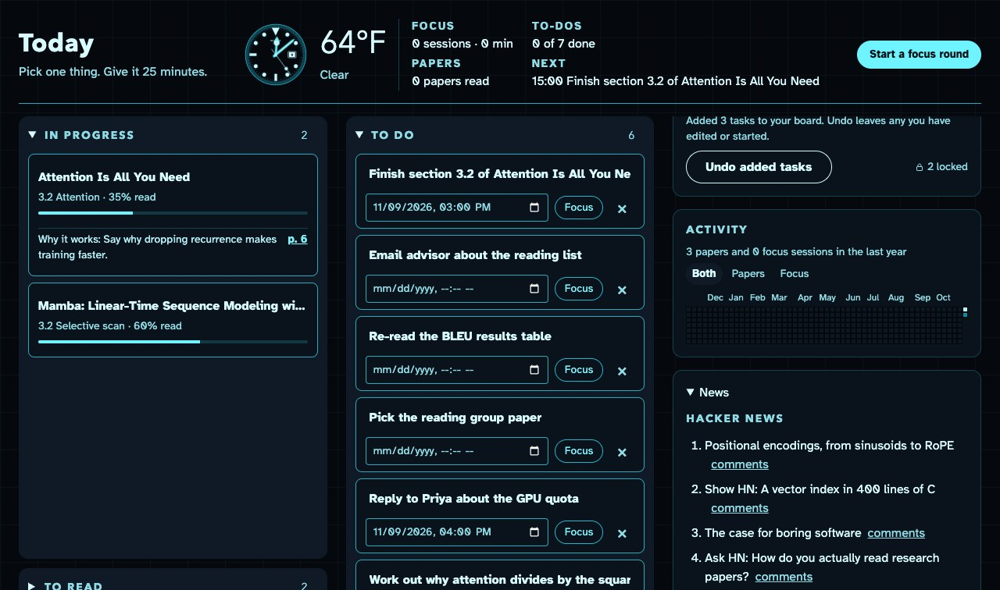
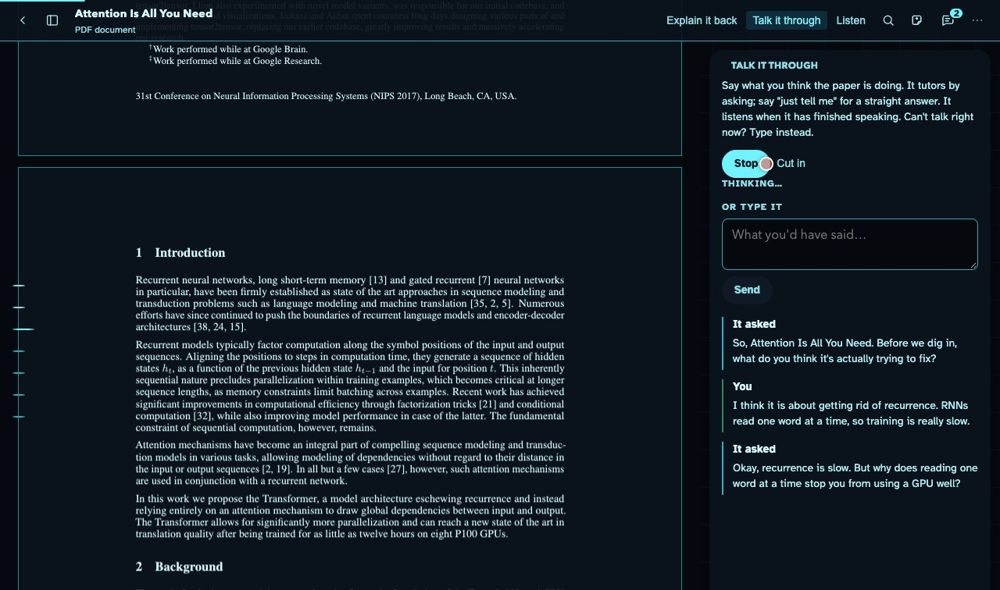
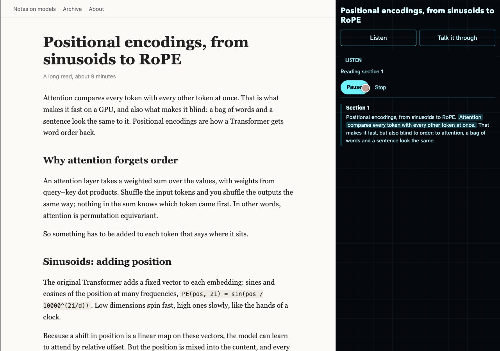
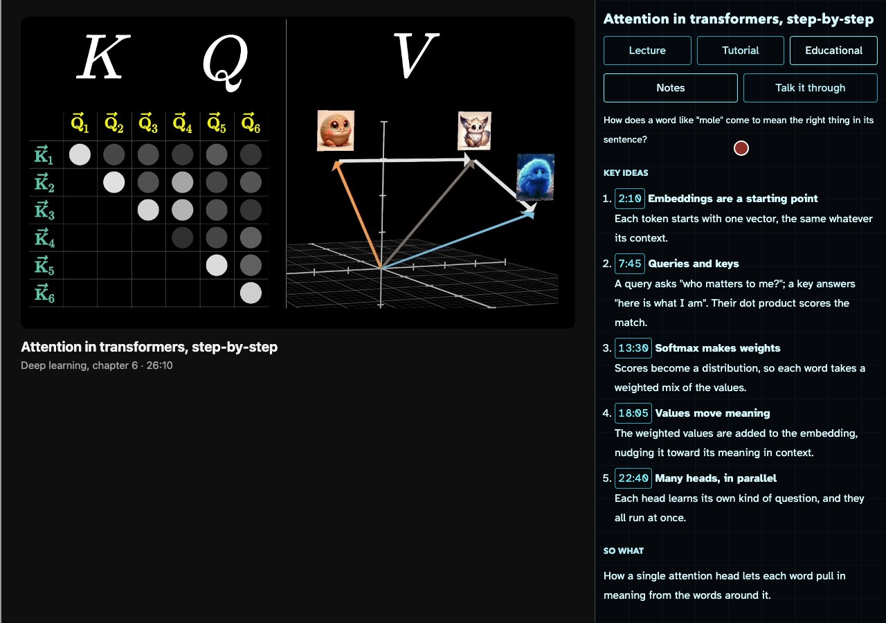
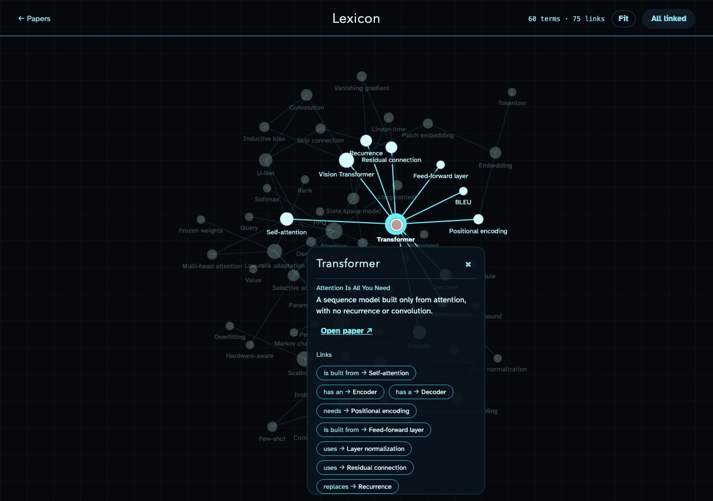

# Reader

**A quiet companion to [alphaXiv](https://www.alphaxiv.org): your paper shelf,
and a reader that asks instead of tells and blocks what pulls you away.**

The failure it is built around is not that papers are hard. It is that another
tab pulls you off the paper. Success is finishing twenty minutes with a paper
and being able to explain it to a friend: the problem, the key trick, and why
it works, even if you never read it end to end.

The extension is written in Rust and compiled to WebAssembly, on a fork of
[oxichrome](https://github.com/0xsouravm/oxichrome) with a
[Leptos](https://leptos.dev) UI. pdf.js and KaTeX stay JavaScript.

Screenshots are frames from the end-to-end demo (`e2e/demo.e2e.ts`), which drives the real extension.











---

## What it does

### Your library is alphaXiv's

Sign in to alphaXiv from Settings and your folders become the shelf. alphaXiv
is the master copy; the extension mirrors it and adds only what alphaXiv does
not keep: how far you got, where you stopped, and when you last read. The
mirror refreshes when a new tab or the papers page opens, and on a timer.

Only arXiv papers are supported. Other PDFs open in Chrome's own viewer.

### The reader

arXiv PDF links open in the extension's reader instead of Chrome's viewer, with
alphaXiv one menu item away.

- **The chrome sleeps.** The toolbar fades a moment after you start reading and
  comes back at the top edge, on scroll-up, or with keyboard focus.
- **Status without noise.** A capsule under the page shows the page and the
  minutes left; click it for page jump and zoom.
- **Section rail.** The outline rests as tick marks on the left edge, the
  current section lit.
- **Focus line.** Press F and a reading band holds your place.
- **Keys for everything.** E, T and L open Explain it back, Talk and Listen;
  N places a note; J and K step through sections; Shift+F is full screen;
  `?` lists them all.
- **The tab names the paper.** The tab title is the paper and the page you
  are on, so a reader tab is easy to find among many.
- **Figure mentions jump.** "Figure 3" in the text goes to the figure, and a
  Back button returns you to where you were reading. Citations and section
  links jump the same way.
- **Highlights and sticky notes**, in four colours, with a notes list to jump
  between them.
- **Find in document**, and **resume where you left off**: the exact page and
  scroll position, saved the moment you switch or close the tab.
- **Explain it back**: unfinished explanations save automatically on this
  device, separately for each paper, even when you close the panel or reload.
- **Click a word to define it.** You write your guess from the sentence around
  it first; then Claude Haiku says what it means in this paper. This is the
  one place the reader tells rather than asks. Keep the definition as a note on
  the term, or not.

### A reading session

While a reader tab is open, the sites on your block list redirect to a quiet
page that names what you were reading. Closing the last reader tab lifts the
block. Blocking is `declarativeNetRequest`, so it holds across service-worker
restarts.

### In the browser itself

- **Toolbar badge**: minutes left in a focus round, or a dot while a reader
  tab is open.
- **Address bar**: type `r`, a space, and a few words of a title to open a
  paper from your shelf where you stopped.
- **Shortcuts** (change them at `chrome://extensions/shortcuts`):
  Alt+Shift+R toggles the side panel, Alt+Shift+P goes back to your paper,
  Alt+Shift+F starts a focus round with your top tasks.
- **Right-click**: "Open in Reader" on an arXiv link, "Add to the lexicon" on
  selected text, and the side panel on any page.

### The new tab

- **Continue reading**: the paper you read last, opened where you stopped,
  with a Resume button at the top of the page.
  Queued and completed papers are tucked into expandable sections.
- **Focus rounds**: start from a task on the board, or choose up to three
  for 25 minutes. Task edits and completion stay in sync with the round.
  An optional YouTube link allows that study video while other videos stay
  blocked. News stays hidden during focus and reading sessions. The time
  left shows in the tab title, in the reader, and (Float timer) in a small
  window that stays above your other tabs.
- **Brain dump**: type what is looping; Claude Haiku hands it back a little
  lighter, and the words go into an encrypted vault (RSA-OAEP and AES-GCM,
  unlocked by your passphrase or a recovery code). The new tab never shows a
  dump; the dumps page does, once unlocked.
  The box shows when vault setup is still needed; submissions remain
  unencrypted until setup finishes. Extracted tasks can be edited on the
  board or undone together.
- **Activity**: a year of reading and focus sessions as a heatmap.

### Design

Six palettes, including dark Grid, with tokens tested for AAA text contrast
(7:1). Reader panels use opaque surfaces; notes and settings use larger body
text. Body text is Atkinson Hyperlegible.
Motion is stilled under Reduce Motion; translucency follows Reduce
Transparency.

---

## Privacy

There is no account of the extension's own. It talks to:

- **alphaXiv**, once you sign in (OAuth with PKCE), for your library;
- **arXiv**, to fetch the PDFs you open;
- **Claude**, with your own key, only for something you ask for: a
  definition, a brain dump, a question, Listen or Talk it through;
- **Groq** (and OpenAI as a fallback voice), with your keys, for speech when
  you Talk it through or Listen;
- **Gemini**, with your key, for notes on a YouTube video you ask about;
- **Hacker News**, for the new tab's news card;
- **Open-Meteo**, for the temperature by the new tab's clock, with your
  rounded location if you allow the browser's location prompt.

Everything else stays in `chrome.storage` on your machine.

---

## Installation

The extension is not on the Chrome Web Store, so you build it and load it
yourself. It works in Chrome, Brave, Edge and other Chromium browsers.

### 1. Install the tools

- [Node.js 22](https://nodejs.org) or newer
- [Rust](https://rustup.rs) (stable), then the WebAssembly target:

  ```sh
  rustup target add wasm32-unknown-unknown
  ```

### 2. Get the code and build it

```sh
git clone https://github.com/aakashvardhan/attention-spanner.git
cd attention-spanner
npm install
npm run build:ext
```

The first build takes a few minutes (it also installs the matching
`wasm-bindgen-cli`). The extension lands in `rust/ext/dist/chromium`.

Shortcut: on macOS double-click **`install.command`** (Linux:
`sh install.command`; Windows: **`install.bat`**). It checks for Node.js and
Rust, builds, opens the extensions page and shows the folder to load.

### 3. Load it into the browser

1. Open `chrome://extensions` (Brave: `brave://extensions`, Edge:
   `edge://extensions`).
2. Turn on **Developer mode** (top right).
3. Click **Load unpacked** and choose the folder `rust/ext/dist/chromium`.
4. Pin the extension from the puzzle-piece menu so its icon stays in the
   toolbar.

Open a new tab: it is now the extension's new tab.

### 4. Add your API keys

Open **Settings** (from the new tab's index, or right-click the toolbar icon →
Options). Every AI feature uses your own key; each one is optional, and a
feature without its key says so instead of failing.

| Key | Used for | Get one |
|---|---|---|
| Anthropic API key | Click-to-define, brain dump, questions, Listen, Talk it through | [console.anthropic.com](https://console.anthropic.com) |
| Groq API key | Talk it through: speech to text, and the tutor's voice | [console.groq.com](https://console.groq.com) |
| Gemini API key | YouTube notes and Talk it through on videos | [aistudio.google.com](https://aistudio.google.com/apikey) |
| OpenAI API key | Fallback voice when Groq's daily speech limit runs out | [platform.openai.com](https://platform.openai.com/api-keys) |

Keys are saved in the browser's local extension storage and sent only to their
own provider.

### 5. Connect your library (optional)

In Settings, click **Sign in to alphaXiv**. Your alphaXiv folders become the
shelves on the papers page and the new tab.

### 6. Use it

- **A paper:** open any arXiv PDF link; it opens in the reader. Use **Listen**,
  **Talk it through** and **Explain it back** from the toolbar.
- **Any webpage or YouTube video:** click the extension's toolbar icon to open
  the side panel for that tab. On a page: Listen (the page scrolls to the
  section being read and marks it) or Talk it through. On a
  video: **Take notes**, then Talk it through.
- **Talking:** the first time, allow the microphone. If the side panel can't
  ask for it, click **Allow the microphone** in the panel; a tab opens and
  asks once.

### Updating

```sh
git pull
npm run build:ext
```

Then click the reload arrow on the extension's card in `chrome://extensions`.

### Sharing without building

```sh
npm run package   # → release/install-reader.command + release/reader-extension-v*.zip
```

Send either file. The `.command` unpacks itself and walks the recipient through
Load unpacked; the zip works on any OS. No Node, npm or Rust needed to install.

---

## Development

```sh
npm run build:ext   # the extension only
npm run test:rust   # cargo test, clippy (native and wasm, -D warnings), rustfmt
npm test            # stylesheet guards, cut-features guard, brain MCP tests
npm run typecheck   # the TypeScript that remains (e2e, brain MCP, tests)
npm run test:e2e    # the browser suite against the built extension (Playwright)
npm run check       # all of the above
```

A pre-commit hook (`.githooks/pre-commit`, installed by `npm install`) runs
`check:fast`: typecheck, unit tests and the Rust checks. CI runs everything,
including the browser suite.

### Project layout

```
rust/
  core/        the rules, pure Rust, tested natively: storage types and
               migrations, alphaXiv OAuth and sync plans, the MCP client's
               protocol, focus rules, annotations, Markdown, the vault format
  ext/         the extension crate (#[oxichrome::extension])
    src/worker/   the background worker: messages, the reading session,
                  PDF redirects, alphaXiv sign-in and sync
    src/pages/    Leptos pages: newtab, papers, reader, sidebar, notes,
                  lexicon, options, blocked, dumps
    js/           the hand-written worker shim, the pdf.js / KaTeX bridges,
                  and the scripts the side panel runs in a tab
    css/          the stylesheets, and the tests that hold them to the
                  design system (AAA contrast, tokens only, motion)
  NOTES.md     what each phase of the port taught, file by file
vendor/oxichrome/   the extended oxichrome fork (pages, newtab, manifest patches)
e2e/                Playwright suite, run against the built extension
eval/               model evals for the side panel and YouTube notes
                    (`npm run eval:sidebar`, `npm run eval:youtube`)
mcp/brain/          the brain MCP server (Node; not part of the extension)
tests/              repository-wide guards (cut features stay cut)
```

### The design system

Every colour, space, radius and duration is a token in `rust/ext/css/theme.css`.
`rust/ext/css/designSystem.test.ts` fails the build on a raw colour, radius or
shadow anywhere else; `theme.test.ts` checks every text/surface pair for 7:1;
`motion.test.ts` checks that every spring is stilled under Reduce Motion.

---

## Permissions

| Permission | Why |
|---|---|
| `storage` | Everything is stored locally |
| `alarms` | The periodic alphaXiv sync, the end of a focus round, and to-do reminders |
| `declarativeNetRequest` | Blocking during a reading session or focus round, and sending arXiv PDFs to the reader |
| `identity` | Signing in to alphaXiv (`launchWebAuthFlow`) |
| `notifications` | To-do reminders, and the end of a focus round or break |
| `offscreen` | Playing the bell at the end of a focus round (a service worker cannot play audio) |
| `geolocation` | The temperature by the new tab's clock |
| `scripting` | Reading the page, or the YouTube player, for the side panel |
| `sidePanel` | The side panel the toolbar icon opens |
| `contextMenus` | "Open in Reader", "Add to the lexicon" and the side panel, on right-click |
| `<all_urls>` | Fetching PDFs for the reader, reaching alphaXiv and the AI providers, and reading the tab the side panel is on |

---

## License

MIT, see [LICENSE](LICENSE).
